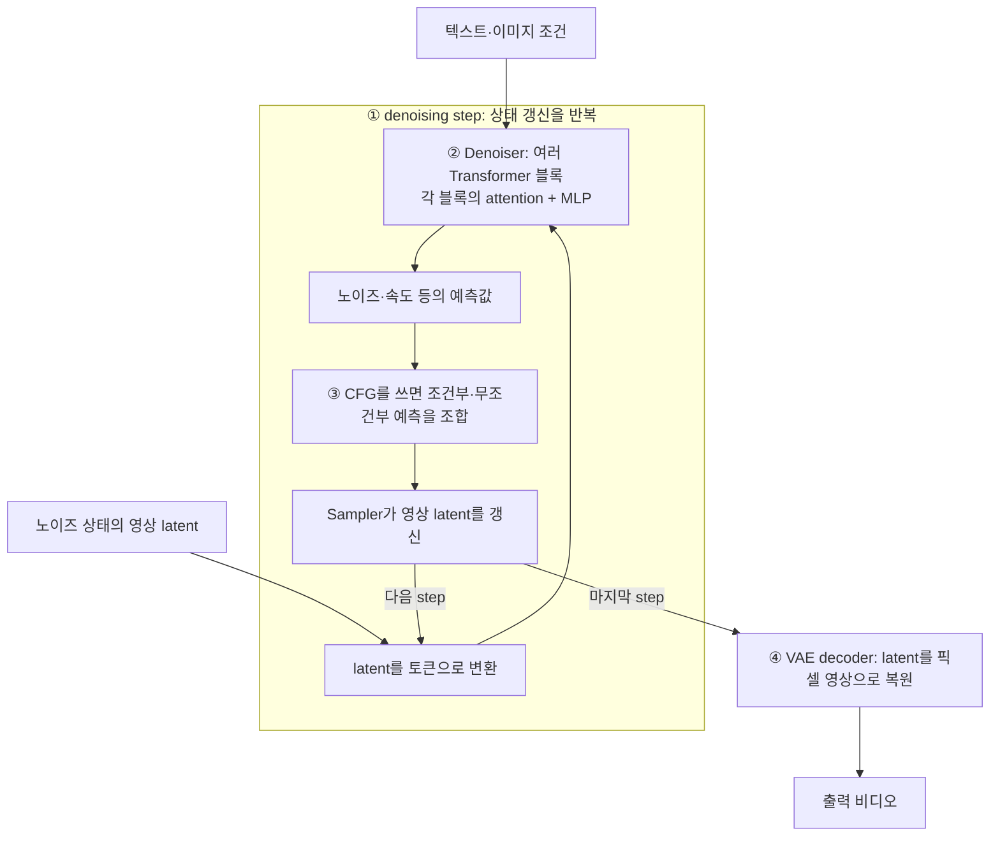

# Efficient Video Diffusion Generation — Related Work 목록

확인일: **2026-10-26**. 비디오 diffusion·flow-matching 생성의 추론 비용을 낮추는 **50편**을 정리했다. [비디오 추론 벤치마크 조사](thread://01a16659-7fb8-7632-bf41-6019ce6358a3?hostId=local)처럼 최초 공개일·학회 정보를 유지하면서, 각 방법을 **‘어디를 바꾸는가 → 원래 어떤 계산을 했는가 → 무엇으로 대체하는가 → 무엇을 보고 결정하는가’**로 설명한다.

## 핵심 아이디어 먼저

비디오 diffusion은 작은 시공간 조각으로 나눈 영상의 압축 표현을 넣고, 신경망의 예측으로 그 표현을 여러 번 갱신한 뒤 영상으로 복원한다. 따라서 **신경망을 호출하는 횟수**, **한 번 호출할 때 통과하는 층과 연산**, **그 연산이 처리하는 토큰·연결·숫자 정밀도**는 서로 다른 효율화 대상이다. 같은 ‘캐싱’이라도 attention 출력만 재사용하는지, 여러 Transformer 블록을 통째로 우회하는지, 일부 토큰만 계산하는지가 다르다. 캐시를 사용할 위치가 같다면 그다음 차이는 **언제 재계산하고, 생략한 출력을 어떻게 채우는가**에 있다.

### 먼저, 한 번의 생성에서 계산이 일어나는 위치

아래는 **latent video DiT의 일반적인 흐름을 단순화한 그림**이다. U-Net 기반 초기 연구와 causal/streaming 모델은 세부 구조가 다르며 해당 표에서 구분한다. I2V의 입력 이미지 인코딩, normalization·residual 연결 등은 그림에서 생략했다. [DiT 입력·스텝 구조](https://arxiv.org/html/2411.19108#S3.SS1) · [비디오 토큰과 attention](https://arxiv.org/html/2502.04507#S2.SS1)

- **① 반복 횟수:** VideoLCM·T2V-Turbo 등은 적은 횟수의 신경망 호출로 생성하도록 모델을 다시 학습한다. 캐싱은 sampling step을 유지하면서 그 안의 비싼 계산을 우회할 수 있다.
- **② 블록 내부:** attention은 토큰끼리 정보를 섞고, MLP는 각 토큰의 특징을 변환한다. PAB는 attention **출력**, TeaCache는 공식 HunyuanVideo 구현에서 Transformer 블록 묶음의 **입출력 차이**, STA는 attention에서 계산할 **토큰 쌍**, SageAttention2는 행렬곱의 **숫자 정밀도**를 다룬다.
- **③ CFG 분기:** 보통 동일한 noisy latent로 조건부·무조건부 두 예측을 구한다. FasterCache의 CFG-Cache는 무조건부 예측을 근사하여 해당 신경망 평가를 줄인다. CFG를 쓰지 않는 모델에는 이 절감 항목이 없다.
- **④ latent·복원:** H3AE는 영상의 압축 비율과 autoencoder 구조를 바꾼다. 그 결과 denoiser가 처리하는 latent 크기와 최종 복원 비용이 달라진다.

**②의 attention 안에서도 위치를 나눠야 한다.** 입력 토큰으로부터 Q·K·V를 만들고, Q와 K의 유사도로 가중치 A를 구한 다음, A로 V를 섞어 출력을 만든다. Sparse attention은 계산할 Q–K 연결을 줄이고, token merging은 연산에 들어가는 토큰을 합치며, 양자화는 해당 곱셈을 더 적은 비트로 수행한다. attention 결과를 다음 denoising step에 재사용하는 캐싱은 이들과 다른 조작이다. [attention 연산 정의](https://arxiv.org/html/2502.04507#S2.SS1) · [저정밀 attention](https://arxiv.org/html/2411.10958#S3)

### 같은 ‘빨라진다’라도 실제로 바뀌는 동작

| 대표 방법 | 기존 계산 → 바뀐 계산 | 무엇이 핵심 차이인가 |
|---|---|---|
| [PAB](https://arxiv.org/abs/2408.12588) | 각 step에서 attention 출력을 다시 구함 → 일정 구간에서는 이전 step의 출력을 전달 | **같은 attention을 언제 다시 계산할지**를 바꾼다. |
| [TeaCache](https://arxiv.org/html/2411.19108#S3.SS3) | 매 step마다 Transformer 블록들을 통과 → 변화가 작다고 판단한 step은 이전 블록 묶음의 residual로 대체 | attention 하나보다 **넓은 블록 구간**을 우회하고, 입력 변화로 우회 여부를 판단한다. |
| [STA](https://arxiv.org/html/2502.04507#S3.SS1) | 현재 step의 모든 토큰 쌍에 attention → 시공간적으로 가까운 tile 사이만 계산 | 현재 step 안에서 **어느 토큰끼리 연결할지**를 바꾼다. |
| [SageAttention2](https://arxiv.org/html/2411.10958#S3) | attention 행렬곱을 고정밀도로 수행 → Q/K의 INT4와 P/V의 FP8 연산 사용 | 연결을 줄이는 대신 **곱셈의 정밀도와 GPU 연산 방식**을 바꾼다. |
| [VideoLCM](https://arxiv.org/abs/2312.09109) | 여러 step에 걸쳐 영상을 복원 → 소수 step으로 복원하도록 학습한 모델을 사용 | **신경망 호출 횟수 자체**를 줄인다. |

## 문서를 읽는 기준

- **효율화 위치:** 단순히 ‘feature’라고 쓰지 않고 attention 출력, 블록 전체의 residual, Q–K 연결, MLP, CFG 분기처럼 실제 연산 위치를 적었다. 방법들이 같은 위치를 바꾸는 경우도 있다.
- **읽는 순서:** 각 분류의 비교표에서 논문·날짜·학회·효율화 위치를 훑고, 바로 아래의 논문별 설명을 읽는다. 각 설명은 **효율화 위치 → 기존 계산과 대체 방식 → 판단 기준·학습/준비** 순서다. 마지막 항목은 추론 중 선택 기준과 사전 학습의 역할을 구분한다.
- **최초 공개일:** 각 논문의 **arXiv v1 제출일(UTC)**이다. 논문명 링크의 Submission history에서 확인한다. 더 이른 OpenReview·코드 공개까지 소급한 절대 최초 공개일은 아니다.
- **학회 accept:** 공식 proceedings·학회 페이지·저자의 공식 논문/프로젝트에서 확인한 채택만 기록했다. 워크숍·Technical Communications·저널을 구분하며 **‘accept 확인 안 됨’은 거절을 뜻하지 않는다.**
- **시간축:** denoising step은 같은 영상 latent를 다듬는 반복이다. 비디오 프레임의 시간축, 또는 다음 프레임 청크를 생성하는 자기회귀 순서와 구분한다.
- **범위와 비용:** 한 방법이 여러 위치를 바꿀 수 있어 분류는 상호 배타적이지 않다. `training-free`라도 calibration·profiling·설정 탐색이 필요할 수 있다. 학습 비용, 연산량 감소, 실제 지연시간 단축은 각각 구분해서 읽는다.

## 1. 캐싱·feature 재사용·예측

**주로 줄이는 것: 같은 영상을 다듬는 denoising step 사이의 반복 신경망 계산.** 비교할 때는 ① 저장하는 tensor가 어디의 출력인지, ② 어느 step에서 다시 계산하는지, ③ 생략한 출력을 단순 복사·residual 덧셈·외삽 중 무엇으로 채우는지를 나눠 본다. Sampling step을 유지해도 그 안에서 실제로 실행하는 신경망 구간은 줄어들 수 있다.

| 논문 | 최초 공개일 | 학회·저널 accept | 효율화 위치 |
|---|---|---|---|
| **[PAB — Real-Time Video Generation with Pyramid Attention Broadcast](https://arxiv.org/abs/2408.12588)** | 2024-08-22 | **[ICLR 2025](https://proceedings.iclr.cc/paper_files/paper/2025/file/092c2d45005ea2db40fc24c470663416-Paper-Conference.pdf)** | 개별 spatial·temporal·cross-attention의 출력 |
| **[FasterCache](https://arxiv.org/abs/2410.19355)** | 2024-10-25 | **[ICLR 2025](https://proceedings.iclr.cc/paper_files/paper/2025/file/518046d86bbc41a0707727c38301ad8e-Paper-Conference.pdf)** | attention 출력 외삽 + CFG 무조건부 분기 생략 |
| **[AdaCache — Adaptive Caching for Faster Video Generation with Diffusion Transformers](https://arxiv.org/abs/2411.02397)** | 2024-11-04 | **[ICCV 2025](https://openaccess.thecvf.com/content/ICCV2025/html/Kahatapitiya_Adaptive_Caching_for_Faster_Video_Generation_with_Diffusion_Transformers_ICCV_2025_paper.html)** | 각 블록의 attention·MLP residual 가지 |
| **[TeaCache — Timestep Embedding Tells: It's Time to Cache for Video Diffusion Model](https://arxiv.org/abs/2411.19108)** | 2024-11-28 | **[CVPR 2025](https://openaccess.thecvf.com/content/CVPR2025/papers/Liu_Timestep_Embedding_Tells_Its_Time_to_Cache_for_Video_Diffusion_CVPR_2025_paper.pdf)** | DiT 블록 묶음 전체의 residual |
| **[TaylorSeer — From Reusing to Forecasting: Accelerating Diffusion Models with TaylorSeers](https://arxiv.org/abs/2503.06923)** | 2025-03-10 | **[ICCV 2025](https://openaccess.thecvf.com/content/ICCV2025/papers/Liu_From_Reusing_to_Forecasting_Accelerating_Diffusion_Models_with_TaylorSeers_ICCV_2025_paper.pdf)** | 계산하지 않는 step의 중간 feature 예측 |
| **[ProfilingDiT — Model Reveals What to Cache: Profiling-Based Feature Reuse for Video Diffusion Models](https://arxiv.org/abs/2504.03140)** | 2025-04-04 | **[ICCV 2025](https://openaccess.thecvf.com/content/ICCV2025/papers/Ma_Model_Reveals_What_to_Cache_Profiling-Based_Feature_Reuse_for_Video_ICCV_2025_paper.pdf)** | 배경에 주로 집중하는 블록 구간 전체 |
| **[MagCache — Fast Video Generation with Magnitude-Aware Cache](https://arxiv.org/abs/2506.09045)** | 2025-06-10 | **[NeurIPS 2025](https://proceedings.neurips.cc/paper_files/paper/2025/hash/311207bb626e36a8f1d3eb92aa67af22-Abstract-Conference.html)** | denoiser residual 재사용 기간의 오차 추정 |
| **[EasyCache — Less is Enough: Training-Free Video Diffusion Acceleration via Runtime-Adaptive Caching](https://arxiv.org/abs/2507.02860)** | 2025-07-03 | **accept 확인 안 됨** — [공식 프로젝트](https://h-embodvis.github.io/EasyCache/)·[저장소](https://github.com/H-EmbodVis/EasyCache) 확인 | denoiser residual + 실행 중 입력·출력 변화 비율 |
| **[HiCache — A Plug-in Scaled-Hermite Upgrade for Taylor-Style Cache-then-Forecast Diffusion Acceleration](https://arxiv.org/abs/2508.16984)** | 2025-08-23 | **[ICLR 2026](https://proceedings.iclr.cc/paper_files/paper/2026/hash/b67c77f8db8b991d73d6f2e16f491840-Abstract-Conference.html)** | Taylor 계열 feature 예측식의 수치 안정성 |
| **[DiCache — Let Diffusion Model Determine Its Own Cache](https://arxiv.org/abs/2508.17356)** | 2025-08-24 | **[ICLR 2026](https://proceedings.iclr.cc/paper_files/paper/2026/hash/78288ef33b18a351c3cd679dc9a15c8d-Abstract-Conference.html)** | 얕은 층을 실제 계산한 뒤 깊은 층만 우회 |
| **[SenCache — Accelerating Diffusion Model Inference via Sensitivity-Aware Caching](https://arxiv.org/abs/2602.24208)** | 2026-02-27 | **[CVPR 2026](https://openaccess.thecvf.com/content/CVPR2026/html/Haghighi_SenCache_Accelerating_Diffusion_Model_Inference_via_Sensitivity-Aware_Caching_CVPR_2026_paper.html)** | 최종 denoiser 출력 재사용 + 민감도 판정 |
| **[NaviCache — Test-Time Self-Calibration Caching for Video Generation](https://arxiv.org/abs/2606.26795)** | 2026-06-25 | **[ICML 2026](https://proceedings.mlr.press/v306/lv26m.html)** | denoiser residual + 변화 비율의 불확실성 추정 |

### PAB

- **효율화 위치:** DiT **개별 spatial/temporal/cross-attention 모듈 출력**, 특히 denoising 중간 구간.

- **기존 계산 → 대체 방식:** 원래 매 step 새로 계산하던 attention의 **출력 tensor**를 저장하고 정해진 후속 step에 그대로 넣어 해당 attention 연산을 건너뛴다. 공간·시간·텍스트 attention을 같은 빈도로 취급하지 않고, 변동이 큰 공간 attention은 짧게, temporal은 중간, cross-attention은 길게 재사용한다. 나머지 block 연산과 sampler는 계속 실행하며, 부록에는 일부 MLP까지 재사용하는 설정도 있다.

- **판단 기준·학습/준비:** **사전 분석에 근거한 고정 schedule.** 모델별로 재사용할 timestep 구간과 attention 종류별 간격을 정한다. 매 영상에서 실제 출력 오차를 측정하여 결정하는 방식은 아니다. 다중 GPU에서는 temporal attention을 재사용하는 step의 관련 sequence-parallel 통신도 함께 줄인다.

**Method 근거:** [§2.3–2.4](https://arxiv.org/html/2408.12588v3#S2.SS3)

### FasterCache

- **효율화 위치:** **Attention 출력 계산**과 **CFG의 unconditional denoiser branch**라는 서로 다른 두 위치.

- **기존 계산 → 대체 방식:** Attention은 최근 두 번 실제 계산한 출력의 차분을 이용해 다음 출력을 **선형 외삽**한다. 단순 복사 대신 `최근 출력 + 가중된 이전 변화량`으로 대체하고 attention 외의 연산은 이어간다. CFG-Cache는 conditional·unconditional 최종 noise prediction에 FFT를 적용하여 두 출력의 **저주파 차이와 고주파 차이**를 저장한다. 생략 step에는 conditional branch만 실행하고, 그 주파수 성분에 저장된 두 차이를 각각 가중해 더한 뒤 역 FFT로 unconditional prediction을 복원하여 CFG를 계산한다.

- **판단 기준·학습/준비:** **고정 refresh 주기와 timestep 가중치.** attention은 기본적으로 **실제 계산 step과 외삽 step을 번갈아 배치**하고, CFG 두 branch도 주기적으로 모두 계산해 주파수 차이를 갱신한다. denoising 진행 단계에 따라 저주파·고주파 보정 비중을 바꾸며, 매번 실제 오차를 알아내어 skip하는 방식은 아니다.

**Method 근거:** [§2.4, Eqs. 4–8](https://arxiv.org/html/2410.19355v2#S2.SS4)

### AdaCache / AdaCache-MoReg

- **효율화 위치:** 각 DiT block의 **attention·cross-attention·MLP residual 가지 출력**.

- **기존 계산 → 대체 방식:** 매 step 각 가지를 다시 실행하던 대신 이전 계산의 가지 출력을 현재 hidden state에 더한다. 즉 현재 입력은 계속 전달되지만 큰 attention/MLP 계산은 캐시로 대체된다. 구현 방향은 layer별 임의 skip보다 **전체 DiT layer에 공통인 재계산 schedule**을 사용하며, refresh step에는 각 layer의 residual을 함께 갱신한다.

- **판단 기준·학습/준비:** **온라인 내용 적응 + 사전에 정한 codebook.** 실제 계산한 두 residual의 L1 거리÷경과 step 수를 구하고, 미리 정한 `변화량 구간 → 다음 재사용 길이` 표에 매핑한다. MoReg는 residual의 프레임 간 차이와 그 값의 step 간 변화까지 측정하여 움직임이 큰 영상은 더 자주 계산한다. 따라서 training-free라도 cache-rate·threshold 설정이 사라지는 것은 아니다.

**Method 근거:** [§4.1–4.3, Eqs. 4–9](https://arxiv.org/html/2411.02397v2#S4.SS1)

### TeaCache

- **효율화 위치:** 모델별 DiT **block 묶음 전체**. 공식 HunyuanVideo 구현은 double/single blocks 전부를 묶는다.

- **기존 계산 → 대체 방식:** 매 step 모든 DiT block을 실행하던 대신, 실제 계산 step에 저장한 **block 묶음의 출력−입력 residual**을 현재 embedded input에 더한다. 재사용 step에도 입력 embedding·판정용 modulation과 최종 출력 head는 실행한다. 따라서 논문의 `model output reuse`를 최종 noise prediction 그대로 복사한다고 일반화하면 구현 경계가 달라진다.

- **판단 기준·학습/준비:** **오프라인 fitting + 온라인 판정.** block 입구에서 timestep에 맞춰 정규화·변조한 입력의 직전 step 대비 상대 L1 변화를 구한다. 사전 fitting한 다항식으로 이를 출력 변화량의 대리값으로 변환해 누적하고, threshold를 넘으면 전체 block을 계산·residual을 갱신한다. 변조된 입력은 출력 변화의 저렴한 신호이고, 다항식은 둘 사이의 척도 차이를 보정한다.

**Method 근거:** [§3.2–3.3](https://arxiv.org/html/2411.19108v2#S3.SS2) · [공식 HunyuanVideo 구현](https://github.com/ali-vilab/TeaCache/blob/main/TeaCache4HunyuanVideo/teacache_sample_video.py#L83)

### TaylorSeer

- **효율화 위치:** DiT **층별 중간 feature의 timestep 방향 변화**; attention/MLP 등 지정된 계산 지점.

- **기존 계산 → 대체 방식:** 단순 cache는 이전 feature 값을 그대로 복사하지만, TaylorSeer는 실제 계산한 여러 anchor의 feature와 **1차·2차 이상 유한차분**을 함께 저장한다. 계산하지 않는 step의 feature를 `마지막 feature + 변화율×경과 step + 고차 변화항`으로 예측하여 해당 feature를 만드는 신경망 연산을 대체한다. 예측 대상은 픽셀 프레임이나 latent의 최종 샘플 자체가 아니라, 적용 지점의 중간 activation이다.

- **판단 기준·학습/준비:** **주기적 실제 계산 + 온라인 차분 갱신.** N step마다 완전히 계산하고 차분 cache를 갱신하며, 중간 N−1 step은 Taylor 다항식으로 예측한다. step 간격으로 차분을 정규화하고, 예측 차수와 refresh 간격을 설정한다. 각 step의 실제 예측 오차를 관측해 refresh 여부를 고르는 기법은 아니다.

**Method 근거:** [§3.1–3.2, Eqs. 4–10](https://arxiv.org/html/2503.06923v2#S3.SS1)

### ProfilingDiT

- **효율화 위치:** **배경에 주로 attention을 주는 DiT block/연속 block 구간**.

- **기존 계산 → 대체 방식:** 모든 block을 매번 계산하던 대신 선택한 배경 중심 block의 **출력 hidden state−입력 hidden state**를 저장해 현재 입력에 더한다. 연속된 block은 묶음의 입출력 차이를 저장하고 떨어진 block은 따로 저장하여 여러 구간을 건너뛴다. 전경 중심 block은 계속 계산한다. 영상의 배경 픽셀만 mask로 잘라 생략하는 방법이 아니라, **어느 block 전체를 재사용할지** 고르는 방법이다.

- **판단 기준·학습/준비:** **Profiling + 재계산 일정.** 모델의 각 step noise prediction에서 채널 차원을 PCA로 3차원으로 줄여 RGB 같은 표현을 만든 뒤, 여기에 SAM2를 적용해 전경 mask를 얻는다. 높은 attention 값을 가진 token과 이 mask의 겹침을 프레임별로 분석·평균하여 전경 중심/배경 중심 block을 구분한다. 초기 warm-up은 실제 계산하고, 이후에는 step에 따라 정한 cache 간격으로 선택된 구간을 재계산한다. 핵심 선택 대상은 배경 픽셀이 아니라 배경에 주로 집중하는 신경망 block이다.

**Method 근거:** [§3.2–3.3, Eqs. 6–15](https://arxiv.org/html/2504.03140v2#S3.SS2)

### MagCache

- **효율화 위치:** 논문 정의상 denoiser의 **residual $r_t=v_\theta(x_t,t)-x_t$** 및 full forward 대체.

- **기존 계산 → 대체 방식:** 원래 현재 noisy latent로 신경망 출력을 다시 구하던 대신, 마지막 실제 계산에서 저장한 residual을 현재 입력에 더해 출력을 근사한다. 주된 기여는 저장한 값을 새로 외삽하는 것보다 **얼마나 오래 재사용해도 되는지 판단하는 magnitude 모델**이다. residual 방향 변화가 작다는 관찰 아래, step별 norm 비율의 곱으로 anchor 대비 상대 변화와 누적 오차를 추정한다.

- **판단 기준·학습/준비:** **단일 calibration 생성으로 사전 측정한 timestep별 크기 비율 + 실행 중 누적.** 누적 오차가 threshold 이하이고 연속 skip 수가 상한 K 이내이면 재사용하며, 아니면 실제 계산 후 reset한다. 이 비율은 현재 입력 feature를 매번 probe해서 얻는 값이 아니므로 TeaCache·EasyCache와 같은 online signal로 묶으면 안 된다. 초기 보호 구간과 K도 설정한다.

**Method 근거:** [§3.1–3.3, Eqs. 3–8](https://arxiv.org/html/2506.09045v2#S3.SS1)

### EasyCache

- **효율화 위치:** denoiser 입출력의 **변환량 $\Delta=v-x$**; full forward 계산.

- **기존 계산 → 대체 방식:** 실제 계산 step의 `출력−입력`을 저장하고, skip step에는 `현재 입력 + 저장한 변환량`을 출력으로 사용한다. 단순 출력 복사와 달리 현재 latent의 이동은 반영하면서 신경망 전체 계산을 피하며, sampler 업데이트는 계속한다. 출력이 얼마나 변할지를 판정할 때는 실제 계산에서 관측한 **출력 변화 크기÷입력 변화 크기**를 하나의 비율로 저장한다.

- **판단 기준·학습/준비:** **오프라인 fitting 없이 온라인 판정.** 마지막으로 얻은 변화 비율에 현재 latent 변화량을 곱해 상대 출력 변화를 추정·누적한다. threshold를 넘으면 full forward로 변환량과 비율을 갱신하고 누적값을 reset한다. 초기 warm-up과 마지막 step은 실제 계산하며, 비율을 매번 신경망 미분으로 얻는 것은 아니다. warm-up 길이·threshold는 여전히 설정값이다.

**Method 근거:** [§III-B–C, Eqs. 2–6](https://arxiv.org/html/2507.02860v1#S3.SS2)

### HiCache

- **효율화 위치:** Taylor-style cache-then-forecast의 **feature 예측식**; 기존 cache 적용 지점 유지.

- **기존 계산 → 대체 방식:** TaylorSeer처럼 실제 계산한 feature와 고차 유한차분을 저장하지만, 예측식의 거듭제곱 항을 **scaled Hermite 다항식**으로 교체한다. 예측되는 것은 지정한 중간 feature의 다음 값이며, 새 attention matrix나 새 latent trajectory를 학습하는 방식이 아니다. 한 scale 값으로 예측 거리와 고차 항의 크기를 함께 축소해 긴 외삽에서 고차 항이 과도하게 커지는 문제를 줄인다.

- **판단 기준·학습/준비:** **고정 간격 refresh + 온라인 차분 갱신.** 정해진 anchor step에서 full forward를 실행하고 feature 차분을 업데이트하며, 그 사이에는 Hermite 기반으로 예측한다. 예측 차수·간격·scale을 정해야 한다. 독립적인 online skip 판정기를 제시하기보다 기존 Taylor 예측기를 교체하는 방법이므로, 캐시 tensor의 정확한 층/모듈 경계는 결합한 framework에 따른다.

**Method 근거:** [§3.2–3.3, Eq. 5 및 Algorithm 1](https://arxiv.org/html/2508.16984v2#S3.SS2)

### DiCache

- **효율화 위치:** DiT의 **앞쪽 얕은 layer는 매 step 계산**, 나머지 깊은 layer를 선택적으로 생략.

- **기존 계산 → 대체 방식:** TeaCache처럼 입력만 보고 판단하지 않고 현재 step의 앞쪽 m개 layer를 실제 실행해 작은 probe를 얻는다. 그 출력이 거의 변하지 않으면 뒤쪽 layer를 생략한다. 또한 최근 두 실제 계산 step의 깊은 residual을 저장하고, **현재 shallow residual이 두 anchor 사이에서 얼마나 이동했는지**로 보간/외삽 계수를 얻어 깊은 residual을 추정한 뒤 현재 입력에 더한다. 단순 과거 residual 복사보다 feature trajectory를 현재 probe에 맞춘다.

- **판단 기준·학습/준비:** **사전 calibration 없는 온라인 probe.** shallow output의 상대 L1 변화를 누적해 threshold와 비교한다. 재계산이 필요하면 이미 계산한 shallow feature부터 남은 layer를 이어 실행한다. probe 깊이·threshold는 설정하며, skip step에도 앞부분 layer 계산 비용은 발생한다.

**Method 근거:** [§3.1–3.2, implicit analysis 및 dynamic trajectory alignment](https://arxiv.org/html/2508.17356v2#S3.SS1)

### SenCache

- **효율화 위치:** denoiser **최종 출력 전체**와 full forward 호출.

- **기존 계산 → 대체 방식:** 매 step 신경망을 실행하는 대신 마지막 anchor의 noise/velocity prediction을 그대로 사용해 다음 sampler 업데이트를 한다. MagCache·EasyCache의 `현재 입력 + 과거 residual`과 달리 **최종 출력 자체를 재사용**하는 full-forward cache다. 재사용 위험은 noisy latent가 얼마나 이동했는지와 timestep이 얼마나 이동했는지를 각각 신경망의 민감도로 가중하여 합산한다.

- **판단 기준·학습/준비:** **모델별 오프라인 sensitivity calibration + 온라인 이동량 판정.** latent만 조금 바꾸거나 timestep만 바꾸어 출력을 비교하는 유한차분으로 두 민감도를 미리 구하고 저장한다; 논문 설정은 8개 영상이다. 실행 중에는 anchor 이후 latent·시간 변화와 저장된 민감도로 점수를 계산해 threshold 또는 최대 연속 skip 수를 넘으면 다시 계산한다. 매 step 전체 Jacobian을 구하는 방법은 아니다.

**Method 근거:** [§4.3–4.5](https://arxiv.org/html/2602.24208v2#S4.SS3)

### NaviCache

- **효율화 위치:** denoiser forward의 **출력−입력 residual 재사용** 및 reuse 판정기의 상태 추정.

- **기존 계산 → 대체 방식:** 공식 HunyuanVideo 구현은 마지막 full forward의 `출력−raw latent 입력`을 저장하고, skip 시 `현재 raw latent + residual`을 반환한다. EasyCache처럼 입력 변화에서 출력 변화를 예측하지만, 마지막 관측 비율 하나를 그대로 믿지 않고 **변화 비율의 추정값과 그 불확실성**을 유지한다. 실제 계산이 일어나면 새 출력 변화/입력 변화 비율을 관측하고, 과거 추정과 새 관측을 불확실성에 따라 섞는다.

- **판단 기준·학습/준비:** **초기 온라인 정렬 + 실행 중 Bayesian 보정; 오프라인 fitting 없음.** 초기 몇 step을 실제 계산해 비율을 잡고, 이후 `예측 비율×입력 변화`를 누적해 threshold를 넘으면 refresh한다. 새 실제 출력이 있어야 비율을 보정할 수 있으며, threshold·초기 정렬 길이·process/measurement noise는 설정값이다.

**Method 근거:** [§3.2.1–3.2.3](https://arxiv.org/html/2606.26795v2#S3.SS2) · [공식 HunyuanVideo 구현](https://github.com/HelloZicky/NaviCache/blob/main/NaviCache4HunyuanVideo/navicache_sample_video.py#L55)

## 2. 희소 어텐션·토큰별 계산 축소

**주로 줄이는 것: attention의 Q–K 연결 또는 token별 계산.** 같은 sparse 계열이어도 고정 공간 window, 현재 입력으로 선택한 K/V block, token 병합, 일부 Q 행만 갱신하는 방법이 다르다. LiteAttention은 연결의 생략 여부를 캐시하고, Astraea는 token 출력의 갱신 빈도를 바꾸므로 둘을 단순 token 삭제로 묶으면 안 된다.

| 논문 | 최초 공개일 | 학회·저널 accept | 효율화 위치 |
|---|---|---|---|
| **[DiTFastAttn: Attention Compression for Diffusion Transformer Models](https://arxiv.org/abs/2406.08552)** | 2024-06-12 | [NeurIPS 2024](https://proceedings.neurips.cc/paper_files/paper/2024/file/0267925e3c276e79189251585b4100bf-Paper-Conference.pdf) | attention의 공간·step·CFG 분기 중복 |
| **[Importance-Based Token Merging for Efficient Image and Video Generation](https://arxiv.org/abs/2411.16720)** | 2024-11-23 | [ICCV 2025](https://openaccess.thecvf.com/content/ICCV2025/papers/Wu_Importance-Based_Token_Merging_for_Efficient_Image_and_Video_Generation_ICCV_2025_paper.pdf) | 선택한 layer에 들어가는 token 수 |
| **[Sparse VideoGen (SVG)](https://arxiv.org/abs/2502.01776)** | 2025-02-03 | [ICML 2025](https://proceedings.mlr.press/v267/xi25c.html) | head별 spatial / temporal Q–K 연결 |
| **[Fast Video Generation with Sliding Tile Attention (STA)](https://arxiv.org/abs/2502.04507)** | 2025-02-06 | [ICML 2025](https://proceedings.mlr.press/v267/zhang25m.html) | 3D tile 주변의 고정 Q–K 연결 |
| **[Efficient-vDiT: Efficient Video Diffusion Transformers With Attention Tile](https://arxiv.org/abs/2502.06155)** | 2025-02-10 | [ICML 2025 ES-FoMo **Workshop**](https://haozhang.ai/publication/) | sampling step 수 + frame 간 Q–K 연결 |
| **[SpargeAttention / SpargeAttn](https://arxiv.org/abs/2502.18137)** | 2025-02-25 | [ICML 2025](https://proceedings.mlr.press/v267/zhang25ch.html) | attention 내부 QK·AV block 및 AV 추가 생략 |
| **[VSA: Faster Video Diffusion with Trainable Sparse Attention](https://arxiv.org/abs/2505.13389)** | 2025-05-19 | [NeurIPS 2025](https://proceedings.neurips.cc/paper_files/paper/2025/hash/dfc310e81992d2e4cedc09ac47eff13e-Abstract-Conference.html) | 저해상도 global attention + 선택한 원본 tile attention |
| **[Sparse VideoGen2 (SVG2)](https://arxiv.org/abs/2505.18875)** | 2025-05-24 | [NeurIPS 2025](https://papers.neurips.cc/paper_files/paper/2025/hash/8bd5148caced2d73cea7b6961a874a49-Abstract-Conference.html) · [Spotlight](https://svg-project.github.io/v2/) | 현재 Q·K cluster 사이의 연결 |
| **[VORTA: Efficient Video Diffusion via Routing Sparse Attention](https://arxiv.org/abs/2505.18809)** | 2025-05-24 | [NeurIPS 2025](https://proceedings.neurips.cc/paper_files/paper/2025/file/0badcb4e95306df76a719409155e46e8-Paper-Conference.pdf) | 블록별 full / local / token 병합 attention 선택 |
| **[Astraea: A Token-wise Acceleration Framework for Video Diffusion Transformers](https://arxiv.org/abs/2506.05096)** | 2025-06-05 | [ICLR 2026](https://proceedings.iclr.cc/paper_files/paper/2026/hash/921ac785fa9edc73cacaf2664f43d234-Abstract-Conference.html) | attention·MLP 출력의 token별 갱신 빈도 |
| **[Radial Attention](https://arxiv.org/abs/2506.19852)** | 2025-06-24 | [NeurIPS 2025](https://papers.neurips.cc/paper_files/paper/2025/hash/18a367688479c1b08b001584218a4443-Abstract-Conference.html) | frame 간 거리에 따른 Q–K 연결 밀도 |
| **[VMoBA: Mixture-of-Block Attention for Video Diffusion Models](https://arxiv.org/abs/2506.23858)** | 2025-06-30 | [ICLR 2026](https://proceedings.iclr.cc/paper_files/paper/2026/hash/d6c4014ff8d95025aa35d831c0f81faa-Abstract-Conference.html) | query별로 접근할 K/V block 선택 |
| **[LiteAttention: A Temporal Sparse Attention for Diffusion Transformers](https://arxiv.org/abs/2511.11062)** | 2025-11-14 | accept 확인 안 됨 ([논문](https://arxiv.org/abs/2511.11062)·[공식 저장소](https://github.com/moonmath-ai/LiteAttention)) | attention tile의 생략 mask를 step 간 재사용 |
| **[CalibAtt: Accelerating Text-to-Video Generation with Calibrated Sparse Attention](https://arxiv.org/abs/2603.05503)** | 2026-03-05 | [ECCV 2026 (공식 코드의 accept 명시)](https://github.com/apple-aiml-research/ml-calibatt) | 사전 고정한 연결 mask + 일부 query 출력의 공간 복사 |
| **[SVG-EAR: Parameter-Free Linear Compensation for Sparse Video Generation via Error-aware Routing](https://arxiv.org/abs/2603.08982)** | 2026-03-09 | [ECCV 2026](https://eccv.ecva.net/Conferences/2026/AcceptedPapers) | cluster별 원본 attention / 평균값 근사 선택 |
| **[Veda: Scalable Video Diffusion via Distilled Sparse Attention](https://arxiv.org/abs/2605.30325)** | 2026-05-28 | [ICML 2026](https://icml.cc/virtual/2026/poster/66331) | 작은 학습된 MLP가 선택한 Q–K tile 연결 |
| **[HyperVAttention (HVA)](https://arxiv.org/abs/2607.03012)** | 2026-07-03 | [NeurIPS 2026](https://neurips.cc/virtual/2026/poster/153122) | sparse attention용 clustering·GPU tile 낭비 |

### DiTFastAttn

- **효율화 위치:** **attention 연산 내부, denoising step 사이, CFG 두 branch 사이.**

- **기존 계산 → 대체 방식:** 매 step의 full attention을 세 방식으로 줄인다. **WA-RS**는 기준 step에서 `full attention 출력 − window attention 출력`을 저장한 뒤, 이후에는 현재 window attention만 새로 계산하고 저장한 차이를 더한다. **AST**는 선택된 layer의 attention 출력 전체를 앞선 step에서 가져오고, **ASC**는 conditional branch의 attention 출력을 unconditional branch에 재사용한다. 이는 attention을 대체하는 것으로 MLP와 diffusion step 전체를 삭제하는 것은 아니다.

- **판단 기준·학습/준비:** 학습 없이 calibration에서 layer·step별 후보 조합을 시험한다. 압축 전후 모델 출력 오차가 임계값 아래인 후보 중 계산을 가장 많이 줄이는 것을 greedy하게 선택하며, 허용되지 않는 위치는 full attention을 유지한다. WA-RS에는 residual 갱신 step이 필요하다.

**Method 근거:** [본문 §3.2–3.5, Eq.1–2, Algorithm 1](https://arxiv.org/html/2406.08552v2)

### Importance-Based Token Merging

- **효율화 위치:** **선택한 diffusion layer에 들어가는 token 수.** Video 실험은 AnimateDiff의 첫·마지막 block에 적용한다.

- **기존 계산 → 대체 방식:** 원래 N개 token을 각각 처리하던 layer를 **소수 destination token과 독립 token만 처리**하도록 바꾼다. 이전 step CFG 크기로 important pool을 만든 뒤 그 안에서 destination을 무작위로 뽑고, 나머지 token은 cosine similarity가 가장 높은 destination으로 평균 병합한다. 단, important pool에서 어떤 destination과도 잘 맞지 않는 token은 독립적으로 보존한다. 처리 후 destination 출력을 병합된 source 위치에 복사하여 원래 N개 위치를 복원하므로 frame을 영구 삭제하지 않는다.

- **판단 기준·학습/준비:** 사전 학습 없이 merging ratio, pool 크기, destination 비율을 정한다. 초기 step에는 구조 보존을 위해 pruning 변형과 공간 분산 destination 선택을 사용한다. 본문은 video의 적용 block을 명시하지만 모든 MLP·temporal-attention에 일괄 적용했다고 명시하지 않으므로 그 범위는 단정하지 않는다.

**Method 근거:** [본문 §3, §4.1; 부록 B의 early-step 처리](https://arxiv.org/html/2411.16720v2) · [공식 method 설명](https://hao-yu-wu.github.io/token_merging/)

### Sparse VideoGen / SVG

- **효율화 위치:** **각 attention head의 QK 및 attention-weight×V 계산 영역.**

- **기존 계산 → 대체 방식:** 모든 video token 쌍을 계산하던 3D attention을 head마다 두 후보 중 하나로 제한한다. **Spatial head**는 같은 frame와 인접 frame의 token을, **temporal head**는 여러 frame의 대응 공간 위치 주변 token을 연결한다. 선택 mask 밖의 QK·AV block을 건너뛰되 token sequence와 선택된 연결의 현재 Q/K/V는 유지한다. Temporal 연결은 메모리에서 띄엄띄엄하므로 token 순서를 바꿔 연속 block으로 만든 뒤 sparse kernel을 실행하고 순서를 복구한다.

- **판단 기준·학습/준비:** 현재 입력의 일부 query 행에서 full·spatial·temporal attention 출력을 실제 계산하여, full 대비 MSE가 작은 패턴을 head별로 선택한다. 따라서 고정 head 분류가 아니라 prompt·step에 반응하는 **online profiling**이다. 추가 학습은 없지만 profiling 계산과 sparsity 폭 설정이 필요하다.

**Method 근거:** [본문 §3.1, §4.1–4.3, Figure 5](https://arxiv.org/html/2502.01776v2)

### Sliding Tile Attention / STA

- **효율화 위치:** **self-attention의 공간·시간 연결을 GPU tile 단위로 제한.**

- **기존 계산 → 대체 방식:** 각 query가 모든 key를 보던 계산을 **자신이 속한 3D tile 주변의 key tile만 보는 계산**으로 바꾼다. 한 query tile의 모든 token이 동일한 window를 공유하도록 하고, tile 내 token을 메모리에 연속 배치한다. 이로써 FlashAttention block이 완전히 계산되거나 완전히 비어 있게 하여, window 경계에 일부 원소만 남는 비효율을 없앤다. 선택된 tile 안에서는 현재 token끼리 정상 attention을 계산하며 token·frame·MLP를 제거하지 않는다.

- **판단 기준·학습/준비:** Training-free 버전은 소수 prompt에서 head별 window 크기를 검색하고 초기 denoising step은 full attention으로 유지한다. 정해진 window는 좌표 기반이며 매 입력에서 중요 token을 찾아 바뀌는 mask가 아니다. 더 작은 window를 사용하는 별도 버전은 model fine-tuning으로 적응시킨다.

**Method 근거:** [본문 §3.1–3.2, Algorithm 1, Figure 5](https://arxiv.org/html/2502.04507v3)

### Efficient-vDiT

- **효율화 위치:** **denoiser 호출 횟수와 호출당 3D attention의 frame 연결.**

- **기존 계산 → 대체 방식:** 먼저 multi-step consistency distillation으로 적은 step의 denoiser를 만든다. 그 안의 full attention은 **같은 latent frame의 diagonal block + 일정 간격으로 고른 소수 global reference frame에 대한 연결**만 남기는 고정 sparse mask로 바꾼다. 따라서 모든 frame token은 계속 존재하지만 대부분의 frame 간 QK·AV 계산이 사라진다. 마지막으로 dense teacher의 attention 출력·MLP 출력과 diffusion 목적함수로 sparse student를 다시 학습해 오차를 줄인다.

- **판단 기준·학습/준비:** Layer마다 유지할 reference-frame 수 후보를 사전 검색한다. 여러 sampled timestep의 hidden-state 오차를 검사해 임계값을 만족하는 sparse mask를 선택하고 추론에는 고정해 사용한다. 단순한 training-free mask 적용이 아니라 **step distillation → layer별 mask search → knowledge distillation**의 준비 과정이다.

**Method 근거:** [본문 §3.1–3.4, Algorithm 1, Eq.2–4](https://arxiv.org/html/2502.06155v2)

### SpargeAttn

- **효율화 위치:** FlashAttention 내부의 **QK·AV block 생략**, 남은 block 안의 **AV 추가 생략**.

- **기존 계산 → 대체 방식:** 먼저 Q/K block을 평균 token으로 요약해 작은 attention map을 계산하고, 중요하지 않은 block의 **QK와 AV를 함께 생략**한다. 단 block 내부 token이 서로 닮지 않았으면 평균으로 대표하기 어려우므로 해당 block은 강제로 계산한다. 1차로 남은 block에서도 실제 QK를 계산한 뒤 online-softmax 값이 충분히 작으면 **AV만 추가 생략**한다. 요약 token은 mask 예측용이며, 선택된 block의 본 계산은 원래 token으로 수행한다.

- **판단 기준·학습/준비:** Block 내부 similarity 임계값, 누적 attention mass, softmax 생략 임계값을 calibration 입력에서 layer별 relative-L1 오차 제약으로 검색한다. 추가 학습은 없다. Video에는 Hilbert-curve 순서 변경으로 인접 token의 유사도를 높이는 기법도 사용한다.

**Method 근거:** [본문 §3.2–3.7, Eq.4–6](https://arxiv.org/html/2502.18137v8)

### VSA

- **효율화 위치:** **full self-attention을 coarse global branch와 fine sparse branch로 교체.**

- **기존 계산 → 대체 방식:** Video latent를 3D cube로 나누고 cube 하나를 GPU tile 하나에 대응시킨다. **Coarse branch**는 cube별 평균 Q/K/V로 모든 cube 간 저해상도 attention을 계산한다. 여기서 query cube마다 점수가 높은 key cube를 고르면 **fine branch**가 해당 cube 쌍의 원래 token끼리만 QK·AV를 계산한다. 최종 출력은 coarse global 출력과 fine 출력을 gate로 결합하므로, coarse 계산은 mask를 고르는 데만 쓰이는 것이 아니라 생략한 영역의 global 문맥도 제공한다.

- **판단 기준·학습/준비:** Cube 크기와 row별 top-k 예산을 정하고 입력마다 mask를 재계산한다. 논문은 training-from-scratch와 pretrained model의 sparse adaptation을 평가한다. Adaptation에서는 새 coarse gate를 0으로 초기화하고 dense에 가까운 상태에서 출발해 sparsity를 점진적으로 높이면서 학습한다. Few-step distillation과 함께 학습하는 변형도 제시한다.

**Method 근거:** [본문 §2.2–2.4, Appendix B](https://arxiv.org/html/2505.13389v5)

### Sparse VideoGen2 / SVG2

- **효율화 위치:** **attention token의 순서와 query-cluster/key-cluster 연결.**

- **기존 계산 → 대체 방식:** 공간 좌표로 고정 block을 만들던 방식 대신 head·layer마다 **Q와 K를 각각 k-means clustering**하고 같은 cluster token을 연속 배치한다. Centroid 간 점수에 key-cluster 크기를 반영해 attention mass를 추정하고, 누적 mass가 top-p 목표에 도달할 때까지 key cluster를 선택한다. 실제 attention은 선택된 cluster 쌍의 **원래 token**으로 계산하고 출력 순서를 복구한다. 따라서 centroid로 token 자체를 영구 대체하거나 token 수를 줄이는 merging 방법은 아니다.

- **판단 기준·학습/준비:** 추가 학습 없이 현재 activation에서 clustering·selection을 수행한다. 이전 denoising step의 centroid를 다음 k-means 초기값으로 재사용해 준비 계산을 줄이며, attention 출력 cache를 그대로 쓰지는 않는다. Cluster 크기가 달라도 과도한 padding 없이 계산하도록 가변 block 크기를 지원하는 kernel을 사용한다.

**Method 근거:** [본문 §4.1–4.3, Eq.1–2](https://arxiv.org/html/2505.18875v5)

### VORTA

- **효율화 위치:** **transformer block의 attention 종류를 step에 따라 선택.**

- **기존 계산 → 대체 방식:** 매 block의 full attention을 항상 계산하는 대신 **full / 3D sliding-tile / core-set attention** 중 하나만 실행한다. Sliding branch는 local tile 연결만 계산한다. Core-set branch는 3D bucket의 중심 token과 가장 유사한 이웃들을 중심에 병합하고, 남은 작은 token 집합에서 attention을 계산한 뒤 중심 출력을 제거했던 위치로 복사해 원래 길이를 복원한다. 따라서 local 연결 생략과 attention 입력 token 압축이 별도 branch이며 이후 FFN 등의 전체 sequence 처리는 계속된다.

- **판단 기준·학습/준비:** Timestep embedding을 받는 block별 linear router가 세 gate 중 최대인 branch를 고른다. 사전 준비에서 세 branch를 함께 실행한 weighted output을 dense teacher와 맞추며 **backbone은 동결하고 router만 학습**한다. Core-set의 bucket 크기·병합 수와 local window는 별도 설정값이다.

**Method 근거:** [본문 §3.2–3.3, Eq.3–8, Figure 5–6; 부록 A.1](https://arxiv.org/html/2505.18809v2)

### Astraea

- **효율화 위치:** **self-attention·cross-attention·MLP의 token별 출력 갱신.**

- **기존 계산 → 대체 방식:** 모든 token 출력을 매 step 새로 계산하는 대신 중요한 token만 갱신하고, 나머지 위치에는 **이전 step의 같은 block 출력 cache**를 넣어 full sequence를 만든다. Cross-attention과 MLP는 미선택 token 계산을 직접 생략한다. Self-attention에서는 **선택한 Q 행만 계산하되 K,V는 전체 현재 token에서 계산**하므로, 갱신 token은 여전히 전체 문맥을 볼 수 있다. Token이나 frame을 영구 제거하는 방식이 아니라 갱신 빈도를 token별로 달리하는 방법이다.

- **판단 기준·학습/준비:** 이전 attention의 LSE 점수, 두 계산 시점 사이 입력 token 변화량, 연속 미갱신 횟수에 대한 penalty를 결합해 순위를 매긴다. 추가 weight 학습은 없지만 총 계산 예산 아래 영상 출력 MSE를 최소화하도록 **step별 갱신 비율을 offline evolutionary search**한다.

**Method 근거:** [본문 §3.2–3.3, Eq.4–7, Figure 3; 부록 self-attention pseudocode](https://arxiv.org/html/2506.05096v4)

### Radial Attention

- **효율화 위치:** **frame 간 거리에 따른 고정 self-attention 연결 밀도.**

- **기존 계산 → 대체 방식:** 모든 frame 쌍을 똑같이 dense하게 계산하는 대신 **가까운 frame끼리는 넓게, 먼 frame끼리는 대응 공간 위치 주변만 좁게** 계산한다. 시간 거리가 두 배인 band로 갈수록 계산 밀도를 절반으로 줄이고, band 내부에서는 공간 diagonal 폭을 줄이다가 매우 먼 구간은 diagonal 자체를 드물게 배치한다. 첫 frame의 attention sink는 유지한다. 이는 좌표로 정해지는 mask이며 현재 attention 중요도를 매번 예측하지 않는다. 실제 kernel은 개별 원소가 아닌 128×128 block 단위로 실행한다.

- **판단 기준·학습/준비:** 기본 sparse 적용은 추가 학습 없이 가능하며 초기 layer·step의 dense 유지 설정이 있다. 별도의 장편 생성 확장은 길이 분포 변화에 적응하기 위해 Q/K/V/output projection에 LoRA를 학습한다. 기본 sparsification과 long-video adaptation의 학습 여부를 분리해야 한다.

**Method 근거:** [본문 §4.2–4.3, Eq.4–6, Figure 5; 부록 D](https://arxiv.org/html/2506.19852v2)

### VMoBA

- **효율화 위치:** **각 query가 접근할 key/value block의 routing.**

- **기존 계산 → 대체 방식:** 전체 K/V를 보던 query가 **선택된 K/V block의 원래 token들만** 보게 한다. Layer를 따라 temporal·spatial·3D block partition을 순환시키고, 각 key block의 평균과 **개별 query**의 similarity를 계산한다. Head 안의 모든 query–key-block 후보를 한꺼번에 정렬해 누적 점수 임계값까지 선택하므로, query마다 동일 개수의 block을 주지 않는다. 전체 query 출력은 남으며, 평균 key는 routing 대표값으로만 사용된다.

- **판단 기준·학습/준비:** Block을 나누는 방식의 순환과 누적 점수 임계값은 정하지만 실제 연결은 현재 Q/K에 따라 달라진다. 논문은 **sparse attention을 사용하는 추가 학습과 training-free inference를 모두 평가**한다. Training-free 설정은 초기 denoising 구간에 full attention을 유지한다. 두 경우 모두 추론 중 query와 평균 key를 비교하는 routing 계산이 필요하다.

**Method 근거:** [본문 §3.1–3.4, Eq.1–4; §4.1 Implementation details, Table 1의 training-free 실험](https://arxiv.org/html/2506.23858v1)

### LiteAttention

- **효율화 위치:** **FlashAttention tile의 실행 여부를 denoising step 사이에 재사용.**

- **기존 계산 → 대체 방식:** 처음 계산하는 tile에서는 실제 QK와 online-softmax의 row maximum 차이로 기여도가 작은지 판단하고 skip-mask에 기록한다. 이후 step에서 그 tile은 mask를 먼저 확인해 **QK·softmax·AV와 불필요한 K/V 읽기를 건너뛴다**. 아직 생략되지 않은 tile은 현재 Q/K/V로 새로 계산하며 새로운 생략 후보를 추가한다. 따라서 저장·재사용하는 것은 attention 출력이 아니라 tile별 실행 여부이고, mask가 갱신되는 동안 계산량이 줄어든다.

- **판단 기준·학습/준비:** 추가 model 학습은 없다. 초기 step 오차가 누적 영향이 크다는 점을 반영해 구간별 허용 relative-L1 오차를 달리 두고 step별 threshold를 calibration한다. Hardware 구현은 warp별 판단을 모아 tile skip-list로 만들어, mask 검사 때문에 GPU pipeline이 멈추는 비용도 줄인다.

**Method 근거:** [본문 §4.1 Algorithm 2, §4.3–4.4, §5.2–5.3](https://arxiv.org/html/2511.11062)

### CalibAtt

- **효율화 위치:** **offline attention block mask + 공간적으로 반복되는 query 행 출력.**

- **기존 계산 → 대체 방식:** 일반 head에서는 모든 attention block 대신 **사전에 저장한 step·layer·head별 mask의 block만** 현재 Q/K/V로 계산한다. 공간 행별 attention이 반복되는 것으로 판정한 head는 별도 경로를 쓴다. 각 frame에서 소수 anchor query 행만 **전체 K/V에 대해** 계산하고, 그 출력을 가까운 공간 행으로 복사한다. 전자는 연결을 줄이고 후자는 계산할 query 수를 줄이는 방식이며, 단순한 이전-step 출력 cache와는 다르다.

- **판단 기준·학습/준비:** Calibration prompt들에서 full attention을 측정해 query block별 누적 attention mass를 보존하는 mask를 만든 뒤, prompt 간 선택 빈도로 합의 mask를 저장한다. Anchor-row 경로는 attention map의 cosine similarity로 판정한다. 추가 weight 학습이나 inference-time routing은 없지만 **model·해상도·step 설정에 맞는 offline calibration과 dictionary 저장**이 필요하다.

**Method 근거:** [본문 §3.2–3.4, Eq.5–10, Figure 5](https://arxiv.org/html/2603.05503)

### SVG-EAR

- **효율화 위치:** **cluster block을 exact attention과 평균값 보상으로 분기.**

- **기존 계산 → 대체 방식:** SVG2식 Q/K clustering 뒤 중요 block만 남기고 나머지를 0으로 버리는 대신, 일부 block은 원래 token의 QK·AV로 계산하고 **나머지는 key/value cluster 평균으로 기여도를 근사**한다. 근사 block에서는 query와 평균 key의 logit 하나, 평균 value와 cluster 크기를 이용한 계산으로 다수 token 연산을 대체한다. 모든 query 출력은 유지되며 생략 영역도 softmax 정규화·출력에 근사적으로 참여한다.

- **판단 기준·학습/준비:** 단순 attention 점수 순위가 아니라 **exact 계산을 평균 근사로 바꿀 때의 추정 오차 ÷ block 크기**가 큰 것을 예산 내에서 우선 exact 계산한다. 오차는 query centroid와 개별 key를 probing하여 추정하고 value-aware 변형도 제시한다. 추가 학습·새 weight 없이 clustering, routing, compensation을 실행한다.

**Method 근거:** [본문 §4.1–4.4, Eq.3–8, Figure 3](https://arxiv.org/html/2603.08982)

### Veda

- **효율화 위치:** **학습된 tile scorer로 full attention의 block 연결 선택.**

- **기존 계산 → 대체 방식:** Q/K tile의 평균만으로 중요도를 정하던 방식 대신 **평균·최대·최소를 묶은 TripPool 통계**를 head별 작은 MLP에 넣어 tile 간 점수를 예측한다. Query tile마다 top-k key tile만 선택하고, 본 attention은 선택된 tile의 원래 token으로 수행해 나머지 QK·AV를 생략한다. Predictor는 선택을 위한 저비용 계산이고 전체 video token은 보존된다. GPU kernel은 선택 K/V tile만 메모리에서 가져와 계산과 전송을 겹친다.

- **판단 기준·학습/준비:** Dense teacher의 token attention을 tile별 max-pooling한 점수로 scorer를 distillation하고, backbone은 sparse 실행에서 diffusion loss로 학습한다. Scorer로 들어가는 backbone feature에는 stop-gradient를 적용한다. 추가로 calibration에서 **layer·head별 3D tile 모양**을 같은 hardware tile 크기 안에서 검색한다. 따라서 training-free·uniform mean-pooling 방법과 구별된다.

**Method 근거:** [본문 §4.1–4.3, Eq.4–9](https://arxiv.org/html/2605.30325)

### HyperVAttention / HVA

- **효율화 위치:** **clustering 기반 sparse attention의 준비 비용과 GPU tile 낭비.**

- **기존 계산 → 대체 방식:** SVG2처럼 cluster별 중요 연결에서 원래 token attention을 계산하되, 모든 token을 모든 centroid와 비교하던 clustering을 **3D local-window centroid 탐색**으로 줄인다. Anchor step에서는 전체 token을 clustering하고 중간 step에서는 assignment가 불안정한 일부 token만 다시 배정한다. 또 query cluster들을 GPU tile의 실제 padding 비용이 줄어드는 방향으로 묶고, 선택 key 집합의 합집합을 계산한다. 이는 token embedding을 평균 하나로 없애는 merging이 아니라 실행 group을 합치는 것이다.

- **판단 기준·학습/준비:** Centroid 점수 기반 top-p mask를 사용하며, 재배정 대상은 최근접/차근접 centroid 거리 비율인 **Lowe's ratio가 큰 token**이다. Cluster 병합은 이론적 token 수보다 GPU가 실제로 처리해야 하는 tile 수를 반영한 비용을 기준으로 한다. 추가 학습 없이 assignment·centroid를 재사용하고, attention 출력 자체는 현재 값으로 계산한다.

**Method 근거:** [본문 §2, §4.1–4.3, Eq.5–10, Algorithm 1](https://arxiv.org/html/2607.03012)

## 3. 증류·소수 스텝 생성

**주로 줄이는 것: 전체 denoiser의 호출 횟수.** 이 계열은 실제 가속 위치가 공통된다. 차이는 적은 호출로도 좋은 영상을 만들도록 teacher의 어떤 정보를 배우고 consistency·reward·adversarial·DMD 목표를 어떻게 쓰는지에 있다. 학습 중 쓰는 reward model이나 discriminator가 추론에서도 실행되는 것은 아니다.

| 논문 | 최초 공개일 | 학회·저널 accept | 효율화 위치 |
|---|---|---|---|
| **[VideoLCM: Video Latent Consistency Model](https://arxiv.org/abs/2312.09109)** | 2023-12-14 | accept 확인 안 됨 | video denoiser 호출 수 + CFG 이중 평가 |
| **[AnimateLCM](https://arxiv.org/abs/2402.00769)** | 2024-02-01 | [SIGGRAPH Asia 2024 **Technical Communications**](https://github.com/G-U-N/AnimateLCM) | 공간·motion 모듈을 포함한 denoiser 호출 수 |
| **[T2V-Turbo](https://arxiv.org/abs/2405.18750)** | 2024-05-29 | [NeurIPS 2024](https://papers.nips.cc/paper/2024/file/8a57aa8e8b57e64a42e95f7dceb0adb9-Paper-Conference.pdf) | video denoiser 호출 수; reward는 학습에 사용 |
| **[SF-V: Single Forward Video Generation Model](https://arxiv.org/abs/2406.04324)** | 2024-06-06 | [NeurIPS 2024](https://proceedings.neurips.cc/paper_files/paper/2024/file/bb80772833b5e7ce85321a4fb50a66e7-Paper-Conference.pdf) | 전체 clip 생성에 필요한 denoiser 호출을 1회로 |
| **[T2V-Turbo-v2](https://arxiv.org/abs/2410.05677)** | 2024-10-08 | [ICLR 2025](https://proceedings.iclr.cc/paper_files/paper/2025/file/e68af7d8a44bc1964f6be4de464e38f9-Paper-Conference.pdf) | 소수 step 생성; motion guidance를 사전 증류 |
| **[rCM: Large Scale Diffusion Distillation via Score-Regularized Continuous-Time Consistency](https://arxiv.org/abs/2510.08431)** | 2025-10-09 | [ICLR 2026](https://proceedings.iclr.cc/paper_files/paper/2026/hash/0534abc9e6db91683d82186ef0d68202-Abstract-Conference.html) | denoiser 호출 수; consistency + DMD 학습 |

### VideoLCM

- **효율화 위치:** 전체 video denoiser의 반복 호출 수, CFG의 조건·무조건 이중 평가

- **기존 계산 → 대체 방식:** 기존에는 같은 video latent 전체에 denoiser를 수십 번 적용하며 조금씩 noise를 제거한다 → noisy latent를 곧바로 clean latent 쪽으로 보내는 consistency predictor를 학습하여 T2V에서는 4–6번 평가한다. 학생의 한 번 평가에는 기존 공간·시간 모듈이 그대로 들어가며, 특정 layer/attention을 건너뛰는 방식은 아니다.

- **판단 기준·학습/준비:** Teacher와 같은 구조·가중치로 초기화한 학생 전체를 학습한다. Teacher의 CFG+DDIM으로 만든 인접 ODE 지점에서 학생과 EMA target의 clean 예측을 맞추며, 고정 guidance를 증류하므로 추론에서는 CFG용 두 번째 denoiser 평가도 필요 없다.

**Method 근거:** [§3.1–3.2, Eqs. 2–5; §4.1](https://arxiv.org/html/2312.09109#S3)

### AnimateLCM

- **효율화 위치:** video denoising 반복 수; 공간·motion 가속 모듈의 학습 분리

- **기존 계산 → 대체 방식:** 이미지 LDM과 temporal motion module로 구성된 video model을 긴 sampling loop로 호출한다 → image consistency acceleration을 먼저 학습하고 temporal motion acceleration을 추가하여, 결합된 video consistency model을 소수 step으로 실행한다. 공간 연산과 시간 연산을 추론 중 번갈아 생략하는 것이 아니라, 둘을 함께 수행하는 denoiser의 호출 횟수를 줄인다.

- **판단 기준·학습/준비:** 일반 이미지로 image acceleration LoRA를 학습한 뒤 video로 motion acceleration을 학습한다. 개인화 style은 별도 이미지 데이터로 배운 weight residual과 가속 residual을 원래 가중치에 합치므로, 별도 style model을 매 step 추가 실행하지 않고 개인화 video dataset도 요구하지 않는다.

**Method 근거:** [§3.1–3.2, Fig. 1](https://arxiv.org/html/2402.00769#S3)

### T2V-Turbo

- **효율화 위치:** 전체 video denoiser의 sampling loop

- **기존 계산 → 대체 방식:** Teacher가 50-step에 걸쳐 video latent를 갱신한다 → consistency student가 4–8-step으로 생성한다. 각 step의 denoiser 계산량은 teacher와 동일하며, 속도 이득은 호출 수 감소에서 나온다.

- **판단 기준·학습/준비:** Teacher 가중치로 초기화한 학생의 LoRA만 consistency loss와 image-text/video-text reward로 학습한 뒤 가중치에 병합한다. Reward는 학습 중 이미 얻은 한 번의 clean 예측을 VAE decode하여 계산하는 품질 지도 신호이며, 추론에서 reward model을 실행하거나 reward에 따라 step을 조기 종료하는 방법은 아니다.

**Method 근거:** [§2; §3.1–3.3; §4 도입부](https://arxiv.org/html/2405.18750#S3)

### SF-V

- **효율화 위치:** image-to-video UNet의 전체 denoising loop

- **기존 계산 → 대체 방식:** SVD가 입력 이미지 조건 아래 noisy video latent를 반복 갱신한다 → 같은 이미지 조건과 noise에서 전체 clip의 clean latent를 **한 번의 generator forward**로 예측한 뒤 VAE decode한다. 한 번에 한 frame씩 생성하는 autoregressive 방식이 아니라, 한 번의 video denoiser 실행으로 clip을 만드는 방식이다.

- **판단 기준·학습/준비:** 사전학습 SVD로 generator와 discriminator backbone을 초기화하고 reconstruction+adversarial loss로 generator를 학습한다. Discriminator는 frozen UNet encoder의 각 downsampling block 뒤에 spatial·temporal head를 붙여 프레임 품질과 시간 일관성을 평가하며, 이 head들과 discriminator 계산은 추론에 남지 않는다.

**Method 근거:** [§3.2–3.3, Fig. 2](https://arxiv.org/html/2406.04324#S3)

### T2V-Turbo-v2

- **효율화 위치:** consistency student의 sampling loop; 비싼 motion guidance의 사전 증류

- **기존 계산 → 대체 방식:** 긴 teacher sampling 및 reference-video motion guidance 계산을, 그 효과를 배운 consistency student의 소수 step 생성으로 대체한다. 구체적으로 reference video의 temporal attention으로 만든 motion energy의 gradient를 teacher ODE solver에 반영하고 그 이동 결과를 학생의 target으로 삼으므로, 추론 때 reference video의 DDIM inversion이나 motion-energy 역전파를 반복하지 않는다.

- **판단 기준·학습/준비:** VideoCrafter2를 consistency loss와 image/video reward로 post-train하며, inversion·teacher target은 학습 전 계산한다. Dataset/reward/guidance 설계는 적은 step의 품질을 개선하는 요소이고 독립적인 연산 pruning은 아니다; 대표 VBench 표는 **16-step** 결과다.

**Method 근거:** [§3.1–3.2, Eqs. 8–11; §4.1 Table 1](https://arxiv.org/html/2410.05677#S3)

### rCM

- **효율화 위치:** 전체 denoiser의 평가 횟수

- **기존 계산 → 대체 방식:** Teacher의 긴 probability-flow ODE 적분을, noisy latent에서 clean endpoint를 예측하는 continuous-time consistency student의 1–4회 평가로 대체한다. 여러 step을 쓸 때에는 clean 예측에 다음 noise level의 noise를 더해 다시 student를 평가하며, attention 연결이나 token 수를 줄이는 방식은 아니다.

- **판단 기준·학습/준비:** Continuous-time consistency loss와 DMD score regularization을 **동시에** 최적화하여 소수 step의 세부·시간 품질을 보완하고 fake-score network도 학습한다. JVP는 consistency의 시간 미분을 계산하는 **학습 연산**이며, 논문의 attention JVP kernel·고정밀 time embedding은 이를 안정적으로 훈련하기 위한 장치다.

**Method 근거:** [§3.1–3.2; §4.1–4.2, Eqs. 6–7](https://arxiv.org/html/2510.08431#S4)

## 4. 자기회귀·스트리밍 생성

**주로 바꾸는 것: 전체 clip을 함께 생성하는 절차를 현재 frame/chunk만 생성하는 절차로 전환.** Few-step 생성과 과거 문맥 KV 재사용이 함께 쓰인다. 과거 clean chunk의 KV를 유지하는 것과 현재 noisy chunk의 출력을 denoising step 사이에 재사용하는 것은 다르다. 첫 chunk가 나오는 지연시간, 최종 전체 영상 시간, 초당 처리량도 구분해야 한다.

| 논문 | 최초 공개일 | 학회·저널 accept | 효율화 위치 |
|---|---|---|---|
| **[CausVid: From Slow Bidirectional to Fast Autoregressive Video Diffusion Models](https://arxiv.org/abs/2412.07772)** | 2024-12-10 | [CVPR 2025](https://openaccess.thecvf.com/content/CVPR2025/papers/Yin_From_Slow_Bidirectional_to_Fast_Autoregressive_Video_Diffusion_Models_CVPR_2025_paper.pdf) | 현재 chunk만 denoise + 과거 clean chunk의 KV |
| **[Self Forcing](https://arxiv.org/abs/2506.08009)** | 2025-06-09 | [NeurIPS 2025](https://proceedings.neurips.cc/paper_files/paper/2025/hash/f4823f831af67a3ef15e41a85434422a-Abstract-Conference.html) | few-step causal 생성 + rolling history KV |
| **[AAPT: Autoregressive Adversarial Post-Training for Real-Time Interactive Video Generation](https://arxiv.org/abs/2506.09350)** | 2025-06-11 | [NeurIPS 2025](https://proceedings.neurips.cc/paper_files/paper/2025/file/3a9468a918fc65dc9ce7b7bd99f4f0ef-Paper-Conference.pdf) | 1회 forward로 다음 latent frame 생성 + 입력 재활용 |
| **[Causal-rCM](https://arxiv.org/abs/2606.25473)** | 2026-06-24 | accept 확인 안 됨 | few-step causal 생성 + 단계별 post-training |

### CausVid

- **효율화 위치:** clip 전체의 양방향 denoising → chunk별 causal denoising, history KV 재계산

- **기존 계산 → 대체 방식:** 전체 clip을 함께 denoise한다 → 현재 chunk만 4-step 생성하고 이전에 **완성된 clean chunk의 K/V**를 모든 현재 step에서 읽는다. 현재 noisy chunk의 Q/K/V는 매 step 새로 계산하며, 완료 후에는 $G(x_0,0)$를 **한 번 더 forward**하여 그 clean chunk의 KV를 history에 추가하므로, 4 denoising step이 총 4회 forward라는 뜻은 아니다.

- **판단 기준·학습/준비:** Bidirectional teacher의 ODE-pair regression으로 causal student를 초기화한 뒤 asymmetric DMD로 증류한다. 학습에서는 데이터 chunk에 서로 다른 noise level을 주는 diffusion-forcing 구성을 사용하며, Self Forcing처럼 자신의 순차 생성 history를 그대로 rollout하여 학습하는 구성과 구별된다.

**Method 근거:** [§4.1–4.4, Algorithm 2; §5 설정](https://arxiv.org/html/2412.07772#S4)

### Self Forcing

- **효율화 위치:** few-step causal 생성의 history KV; 긴 video의 sliding-window 중복 계산

- **기존 계산 → 대체 방식:** 현재 frame/chunk만 소수 step으로 생성하고 완료된 clean 출력에서 KV를 갱신한다. 긴 video에서는 window를 옮길 때 겹치는 과거 frame들의 KV를 다시 만들던 계산을, 가장 오래된 항목만 버리고 새 항목을 추가하는 rolling KV cache로 바꾼다; 현재 noisy chunk를 step 간 그대로 cache하는 것은 아니다.

- **판단 기준·학습/준비:** 핵심 학습 변경은 clean/noised 정답 history 대신 **학생 자신의 순차 생성 결과**를 조건으로 rollout하고 전체 video에 DMD/SiD/GAN 계열 loss를 적용하는 것이다. 학습 메모리를 줄이려고 선택된 마지막 denoising 평가만 역전파하고 이전 KV gradient를 끊으며, 이 self-rollout은 품질·exposure-bias 개선이지 별도의 step 생략 규칙은 아니다.

**Method 근거:** [§3.2–3.4, Algorithms 1–2](https://arxiv.org/html/2506.08009#S3)

### AAPT

- **효율화 위치:** per-latent-frame 생성; clean-context 재평가; 제한된 history attention

- **기존 계산 → 대체 방식:** Bidirectional video DiT를 block-causal generator로 바꾸고, **직전 clean latent frame을 새 noise·control과 channel 방향으로 concat**하여 다음 latent frame 전체를 한 번에 출력한다. 이 input recycling 때문에 one-step diffusion forcing의 noisy-frame 생성 후 clean-frame KV용 추가 forward가 필요 없으며, 각 생성 pass의 과거 KV를 재사용하고 최근 N frame+첫 frame+text로 attention 범위를 제한한다.

- **판단 기준·학습/준비:** Diffusion adaptation → consistency distillation 초기화 → 실제 생성 결과를 다시 입력하는 student-forcing adversarial training의 세 단계다. Cache는 이 recycled-input pass에서 얻은 상태이며, CausVid의 별도 clean-pass cache와 동일한 구성으로 설명하면 안 된다.

**Method 근거:** [§2.1–2.2, Figs. 1–2](https://arxiv.org/html/2506.09350#S2)

### Causal-rCM

- **효율화 위치:** few-step autoregressive denoising; 학습 시 clean-context/noisy-target 처리

- **기존 계산 → 대체 방식:** 전체 clip의 양방향 반복 denoising을 현재 chunk의 few-step causal 생성으로 바꾸고, 이전 생성 chunk의 KV를 조건으로 재사용한다. TF 학습에서는 clean history와 noisy target을 한 sequence에 묶어 특수 attention mask로 한 번에 처리하고 noisy 부분에만 loss를 주는데, 이것은 **학습 forward의 구성**이며 추론에서 두 video를 계속 생성하는 방식이 아니다.

- **판단 기준·학습/준비:** **TF causal adaptation → TF consistency distillation → self-forcing DMD refinement**를 순서대로 수행한다. TF-CM은 동일 clean history를 보는 causal teacher를 쓰고 SF-DMD는 자신의 rollout에 bidirectional teacher/fake-score를 쓰므로, CM+DMD를 동시 최적화하는 원래 rCM과 구별된다.

**Method 근거:** [§3.1–3.1.2, Fig. 4, Eqs. 8–11](https://arxiv.org/html/2606.25473#S3)

## 5. 양자화·모델 압축·통합 가속·시스템

**한 가지 중복 제거 원리로 묶기 어려운 계열.** 양자화는 곱셈·메모리의 정밀도, pruning은 신경망 크기, autoencoder는 latent 크기와 복원 연산을 바꾼다. GPU 병렬화는 계산을 나눠 지연시간을 줄이는 방법이고, 통합 가속은 여러 기법을 결합한다. 따라서 아래 항목은 각각 어느 부품을 바꿨는지를 중심으로 읽는다.

| 논문 | 최초 공개일 | 학회·저널 accept | 효율화 위치 |
|---|---|---|---|
| **[ViDiT-Q: Efficient and Accurate Quantization of Diffusion Transformers for Image and Video Generation](https://arxiv.org/abs/2406.02540)** | 2024-06-04 | **[ICLR 2025](https://proceedings.iclr.cc/paper_files/paper/2025/hash/a4a1ee071ce0fe63b83bce507c9dc4d7-Abstract-Conference.html)** | projection·FFN 등 linear layer의 정밀도 |
| **[QVD: Post-training Quantization for Video Diffusion Models](https://arxiv.org/abs/2407.11585)** | 2024-07-16 | **ACM MM 2024** — [저자 arXiv accept 명시](https://arxiv.org/abs/2407.11585) | UNet 양자화, 특히 denoising timestep feature |
| **[xDiT: an Inference Engine for Diffusion Transformers (DiTs) with Massive Parallelism](https://arxiv.org/abs/2411.01738)** | 2024-11-04 | **accept 확인 안 됨** — [공식 저장소](https://github.com/xdit-project/xDiT) | token·layer·CFG 분기의 GPU 배치·통신 |
| **[SageAttention2: Efficient Attention with Thorough Outlier Smoothing and Per-thread INT4 Quantization](https://arxiv.org/abs/2411.10958)** | 2024-11-17 | **[ICML 2025](https://proceedings.mlr.press/v267/zhang25ae.html)** | attention 내부 QK·PV 행렬곱의 정밀도 |
| **[VDMini: Individual Content and Motion Dynamics Preserved Pruning for Video Diffusion Models](https://arxiv.org/abs/2411.18375)** | 2024-11-27 | **[ACM MM 2025](https://sites.google.com/site/yimingwu0/home)** — 저자 공식 홈페이지 | denoiser 블록 수 + VAE decoder 구조 |
| **[H3AE: High Compression, High Speed, and High Quality AutoEncoder for Video Diffusion Models](https://arxiv.org/abs/2504.10567)** | 2025-04-14 | **accept 확인 안 됨** — [저자 홈페이지의 Preprint 표기](https://wuyushuwys.github.io/) | 시공간 latent 압축률 + autoencoder 연산 |
| **[Q-VDiT: Towards Accurate Quantization and Distillation of Video-Generation Diffusion Transformers](https://arxiv.org/abs/2505.22167)** | 2025-05-28 | **[ICML 2025](https://proceedings.mlr.press/v267/feng25q.html)** | linear 양자화 + 작은 residual 오차 보정 |
| **[TurboDiffusion: Accelerating Video Diffusion Models by 100–200 Times](https://arxiv.org/abs/2512.16093)** | 2025-12-18 | **accept 확인 안 됨** — [공식 저장소](https://github.com/thu-ml/TurboDiffusion) | sampling step + sparse attention + 저정밀 kernel |

### ViDiT-Q

- **효율화 위치:** DiT projection·FFN 등의 **linear layer** weight/activation 정밀도

- **기존 계산 → 대체 방식:** FP linear matmul을 channel-wise quantized weight와 **매 forward의 token별 min/max로 scale을 구하는 activation quantization**으로 대체한다. Channel outlier는 고정 scaling 후 rotation으로 분산시키고, 낮은 bit에서 민감한 layer·denoising 구간은 높은 precision을 배정한다; softmax attention의 $QK^\top$, $PV$ matmul 자체를 양자화하는 SageAttention과 대상이 다르다.

- **판단 기준·학습/준비:** 기본 모델을 재학습하는 방식은 아니지만 scaling·mixed-precision 설정에 통계와 sensitivity 분석이 필요하다. Token/frame/step 개수는 유지하며, 실제 저비트 linear kernel로 각 denoiser 평가의 저장·전송·행렬곱 비용을 줄인다.

**Method 근거:** [§4.1–4.3; Appendix A.1, E.2](https://arxiv.org/html/2406.02540v3#S4)

### QVD

- **효율화 위치:** UNet 기반 VDM의 weight/activation 양자화; denoising-timestep embedding 보존

- **기존 계산 → 대체 방식:** Weight와 activation을 저비트화하되, ResBlock에 주입되는 **denoising timestep feature**는 작은 값들이 uniform quantizer에서 한 값으로 뭉개지므로 shift를 둔 log quantizer로 바꾼다. Attention 뒤 activation의 서로 다른 channel 범위는 SCRI scaling으로 맞추고 이를 LayerNorm·후속 linear/conv에 동치 변환으로 접어 넣어 추론 시 별도 scaling 비용을 없앤다.

- **판단 기준·학습/준비:** PTQ calibration으로 timestep 구별도+MSE를 이용해 log quantizer의 scale/shift를 찾고, block-output MSE로 SCRI를 탐색한다. 여기서 temporal feature는 **video frame의 time axis가 아니라 diffusion noise timestep embedding**이며, frame/denoising step을 버리거나 재사용하는 방법은 아니다.

**Method 근거:** [§3.3; §4.1–4.2, Eqs. 11–15](https://arxiv.org/html/2407.11585v2#S4)

### xDiT

- **효율화 위치:** denoiser의 token·layer·CFG branch를 여러 GPU에 배치; 통신 대기

- **기존 계산 → 대체 방식:** 한 GPU가 모든 token/layer와 CFG 두 branch를 계산한다 → sequence parallel은 token을 나누고 Ulysses all-to-all로 head를 분배하거나 Ring으로 KV block을 교환하며, CFG 두 branch도 GPU group에 나눠 실행 후 합친다. PipeFusion은 연속 layer와 latent patch를 동시에 분할하여 pipeline을 만들고, 아직 도착하지 않은 patch context에는 이전 denoising step의 activation을 사용하여 통신과 계산을 겹친다.

- **판단 기준·학습/준비:** 모델 재학습 없이 병렬도를 hardware topology에 맞춰 구성한다. SP·CFG 병렬화는 주로 더 많은 GPU로 같은 일을 나눠 latency를 줄이므로 전체 FLOPs 감소와 같지 않으며, PipeFusion에는 인접 step activation의 근사가 들어간다.

**Method 근거:** [§4.1.1–4.2; §5.1](https://arxiv.org/html/2411.01738#S4)

### SageAttention2

- **효율화 위치:** attention 내부의 $QK^\top$, softmax 후 $PV$ 행렬곱

- **기존 계산 → 대체 방식:** Dense attention에서 FP16/BF16으로 수행하던 두 matmul을, **Q/K는 per-thread INT4, P/V는 FP8** 연산으로 대체한다. Q/K의 token 방향 평균을 제거해 outlier를 줄인 뒤 필요한 score 보정항을 다시 더하고, PV에는 두 단계 누산을 사용하여 저정밀 오차를 줄인다; token 사이 연결을 sparse하게 지우거나 이전 step attention을 재사용하지 않는다.

- **판단 기준·학습/준비:** 사전학습 가중치의 재학습 없이 activation에서 online scale을 계산하는 kernel 교체 방식이다. 낮은 bit Tensor Core의 처리량을 활용하는 방법이므로 모델·GPU·sequence 길이에 따른 실제 latency와 kernel 지원을 구분해 보아야 한다.

**Method 근거:** [§3.1–3.4, Fig. 3](https://arxiv.org/html/2411.10958#S3)

### VDMini

- **효율화 위치:** denoiser의 block 수; VAE decoder의 layer/channel 수

- **기존 계산 → 대체 방식:** 원래 UNet의 모든 ResBlock–AttentionBlock 쌍을 매 step 실행한다 → block을 identity/단일 convolution으로 바꿔 중요도를 평가한 뒤 덜 중요한 block을 실제 구조에서 제거한다. 대표 SF-V 설정은 움직임에 민감한 부분을 보존하면서 down/up 경로와 가운데 block을 줄인다. SF-V의 VAE decoder에도 layer·channel pruning을 적용하므로, denoiser 한 번의 실행 비용뿐 아니라 마지막 영상 복원 비용도 줄어든다.

- **판단 기준·학습/준비:** Pruned student를 원래 teacher의 frame별 중간 feature에 맞추는 ICD, multi-frame adversarial loss, 원래 task loss로 재학습한다. 기존 one/few-step 모델에도 적용되는 **한 번의 forward를 작게 만드는** 방식이며, 제시한 block 선택은 SF-V UNet 설정으로 DiT에 그대로 일반화하지 않는다.

**Method 근거:** [§3.2–3.3, Figs. 1–2](https://arxiv.org/html/2411.18375#S3)

### H3AE

- **효율화 위치:** video latent의 시공간 token 수; VAE encoder/decoder

- **기존 계산 → 대체 방식:** 시간·높이·너비를 각각 $4\times8\times8$로 줄이는 압축 대신 $8\times32\times32$로 줄인다. 같은 해상도·길이의 영상에서 latent 위치 수가 이 비교 기준의 1/32이 되므로, 이후 DiT의 **매 denoising step**이 처리할 token 수가 줄어든다. Autoencoder 자체는 고해상도 단계에 frame별 Conv2D를 쓰고, 낮은 해상도 단계에 causal Conv3D를 배치한다. Attention은 가장 압축된 bottleneck에 넣고, decoder는 PixelShuffle로 공간 크기를 복원하여 복원 연산도 효율화한다.

- **판단 기준·학습/준비:** 새 AE를 학습하고 그 latent 공간에 맞는 denoiser를 학습·적용해야 한다. Latent-consistency loss는 복원 video를 재인코딩한 posterior와 원본 posterior를 맞추는 **AE 학습 loss**로, VideoLCM식 denoising-step consistency distillation이 아니다.

**Method 근거:** [§3.1–3.3, Fig. 2](https://arxiv.org/html/2504.10567#S3)

### Q-VDiT

- **효율화 위치:** video DiT의 linear weight/activation; 양자화 오차 보정

- **기존 계산 → 대체 방식:** FP linear $XW^\top$를 quantized activation·weight의 matmul로 바꾸되, 출력에 작은 rank-1 residual을 더한다. TQE는 quantized 입력에 frame별 token scaling $\mathcal M_i$를 적용한 뒤 두 벡터 $\alpha,\beta$로 residual을 계산하여, 모든 weight를 고정밀로 되돌리지 않고 token·feature 차원의 오차를 보정한다.

- **판단 기준·학습/준비:** Weight channel-wise·activation dynamic token-wise quantization을 사용하며, post-training calibration에서 quantizer와 TQE 파라미터를 최적화한다. TMD는 단순 출력 MSE에 frame 간 관계분포의 KL loss를 더하는 **학습 지도**이고, sampling step 단축이나 runtime frame matching 계산은 아니다.

**Method 근거:** [§3.2–3.3, Eqs. 7–15; Appendix B](https://arxiv.org/html/2505.22167v1#S3)

### TurboDiffusion

- **효율화 위치:** sampling 횟수 + attention 연산량/정밀도 + linear 정밀도

- **기존 계산 → 대체 방식:** 기존 100-step denoising을 rCM으로 3–4-step으로 줄이고, full attention을 중요 block의 정확한 sparse attention과 작은 weight의 linear 근사를 합치는 SLA로 교체한 뒤 SageAttention2++ 기반 SageSLA 저정밀 kernel로 실행한다. 별도로 linear layer weight와 activation은 **128×128 block별 INT8**로 양자화하여 INT8 Tensor Core matmul로 바꾸고 LayerNorm/RMSNorm kernel도 최적화하므로, 여러 서로 다른 효율화의 조합이다.

- **판단 기준·학습/준비:** SLA에 적응하는 fine-tuning과 rCM distillation을 따로 수행한 다음 두 parameter update를 병합하고 추론용 kernel·양자화를 적용한다. 따라서 training-free 단일 cache 기법이 아니며, 논문에서 보고한 주요 generation latency는 text encoding과 VAE decoding을 제외한 범위다.

**Method 근거:** [§1.1–1.3; §2.1–2.2](https://arxiv.org/html/2512.16093#S1) · [SLA §4](https://arxiv.org/html/2509.24006#S4)

## 6. 이미지 diffusion에서 출발한 선행 연구

**비디오 방법의 배경으로 읽을 선행연구.** DeepCache의 U-Net 깊은 경로와 video DiT의 block residual은 구조가 다르다. TGATE는 self-attention과 cross-attention이 중요한 생성 시기가 다르다는 관찰을 이용한다. 이미지 중심 결과를 비디오에서 검증된 성능으로 옮겨 읽지 않는다.

| 논문 | 최초 공개일 | 학회·저널 accept | 효율화 위치 |
|---|---|---|---|
| **[DeepCache — Accelerating Diffusion Models for Free](https://arxiv.org/abs/2312.00858)** | 2023-12-01 | **[CVPR 2024](https://openaccess.thecvf.com/content/CVPR2024/html/Ma_DeepCache_Accelerating_Diffusion_Models_for_Free_CVPR_2024_paper.html)** | U-Net 깊은 경로의 feature 재사용 |
| **[TGATE / T-GATE — Faster Diffusion via Temporal Attention Decomposition](https://arxiv.org/abs/2404.02747)** | 2024-04-03 | **[TMLR 2025](https://openreview.net/pdf?id=xXs2GKXPnH)** | 생성 전반부 self-attention·후반부 cross-attention |

### DeepCache

- **효율화 위치:** **U-Net 깊은 main branch**; 이미지 diffusion에서 출발한 선행연구.

- **기존 계산 → 대체 방식:** 원래 shallow downsampling→깊은 down/middle/up blocks→shallow upsampling을 모두 실행한다. DeepCache는 선택한 skip-connection 합류 지점에서 **이전 deep upsampling block의 고수준 feature**를 저장한다. 재사용 step에는 현재 입력의 shallow down path만 새로 계산해 저수준 feature를 얻고, 과거 deep feature와 concatenate한 후 남은 shallow up path를 실행한다. 깊은 중앙 구간은 생략하지만 현재 입력의 세부 변화와 최종 출력 계산은 유지한다.

- **판단 기준·학습/준비:** **정해진 cache 깊이·refresh schedule.** 기본은 한 번 full U-Net 후 N−1번 partial inference이며, 변화가 큰 시점에 full 계산을 더 배치하는 비균일 schedule도 제시한다. 매 프레임이 같은지를 판정해 비디오 frame을 재사용하는 방식이나 DiT 전체 residual cache와 구분해야 한다.

**Method 근거:** [§3.3, Eqs. 4–5 및 1:N inference](https://arxiv.org/html/2312.00858v2#S3.SS3)

### TGATE / T-GATE

- **효율화 위치:** **초기 self-attention, 후기 cross-attention**; 이미지 diffusion 중심 선행연구.

- **기존 계산 → 대체 방식:** 초기 의미 형성 구간에는 cross-attention을 계속 실행하고, warm-up 뒤 self-attention 출력만 일정 간격으로 재사용한다. gate step에서 각 cross-attention의 **conditional·unconditional 출력 평균**을 anchor로 저장한 뒤, 후기 세부 개선 구간에서는 cross-attention 계산을 이 고정값으로 대체하고 self-attention은 계속 실행한다. residual 경로와 다른 연산이 남으므로 attention 값을 고정해도 denoiser 최종 출력이 매번 같아지는 것은 아니다.

- **판단 기준·학습/준비:** **고정 phase 분할 및 주기.** gate step, 초기 warm-up, self-attention 갱신 간격 k를 정한다. online feature 변화에 따른 adaptive threshold가 아니라, attention 종류별로 중요한 denoising 시기가 다르다는 분석을 이용한 schedule이다. 전체 denoiser 출력 재사용이나 단순한 ‘텍스트 embedding cache’와 다르다.

**Method 근거:** [§4.1–4.2, Eq. 6 및 Fig. 5](https://arxiv.org/html/2404.02747v3#S4.SS1)

## 7. 여러 후보의 탐색 비용을 다루는 인접 연구

**주로 줄이는 것: 여러 생성 후보를 시험하는 전체 탐색 예산.** 각 후보 내부의 캐싱을 이용하지만 후보 사이에 feature를 공유하는 방법은 아니다. 한 영상의 생성 속도와 후보 선택까지 포함한 전체 비용을 구분한다.

| 논문 | 최초 공개일 | 학회·저널 accept | 효율화 위치 |
|---|---|---|---|
| **[CachedSearch — Training-Free Cached Exploration for Test-Time Search in Video Diffusion](https://arxiv.org/abs/2607.23159)** | 2026-07-25 | **accept 확인 안 됨** — [저자 프로젝트](https://shreshthsaini.github.io/CachedSearch/)·[저장소](https://github.com/shreshthsaini/CachedSearch) 확인 | 여러 seed 탐색: 후보별 cached 생성 후 선택 seed 재생성 |

### CachedSearch

- **효율화 위치:** **여러 seed 후보를 생성·평가·선택하는 search 전체**. 각 후보 내부에는 full-forward cache 적용.

- **기존 계산 → 대체 방식:** 원래 N개 후보를 모두 full compute로 만든 뒤 고르는 대신, N개를 cache로 저렴하게 생성하고 verifier로 점수를 매긴다. 기본 recommit 방식은 우승 seed만 처음 noise부터 full compute로 다시 생성한다. 후보 내부 cache는 EasyCache식 `출력−입력` 변환량을 저장해 현재 입력에 더하되, **후보 간 feature를 공유하지 않고 매 후보마다 reset**한다. 따라서 효율화 목표는 한 영상의 동일성뿐 아니라 제한 예산에서 더 넓게 탐색하는 것이다.

- **판단 기준·학습/준비:** **온라인 input-drift 기준 + 초기/마지막 보호 step.** 마지막 실제 계산 input 대비 현재 input의 상대 Frobenius 변화를 누적하고 threshold를 넘으면 refresh한다. conditional/unconditional branch는 cache와 skip 판정을 따로 유지한다. 후보 순위가 얼마나 보존되는지 별도 검증하며, keep-draft 변형도 있으나 recommit은 최종 선택된 seed의 full-compute 영상을 제공한다.

**Method 근거:** [§3.1–3.2, Eqs. 3–5 및 Algorithm 1](https://arxiv.org/html/2607.23159v2#S3.SS1)

## 용어 메모

- **Latent / token:** latent는 영상을 압축한 내부 표현이고, token은 그 표현을 시공간 조각으로 나눠 신경망에 넣은 단위다. token 수·계산을 줄인다고 출력 프레임을 반드시 삭제하는 것은 아니다.
- **Feature / residual:** feature는 신경망 내부의 중간 벡터다. 이 문서의 캐싱 문맥에서 residual은 대개 **지정한 계산 구간의 출력−입력 차이**다. 그 구간은 attention 가지, DiT block 묶음, denoiser 전체 등 방법마다 다르다. 영상에 남아 있는 노이즈 자체를 뜻하지 않는다.
- **Transformer 블록 / attention 타일:** Transformer 블록은 attention·MLP 등을 포함한 신경망의 한 층 묶음이다. attention 타일은 큰 Q–K 행렬에서 GPU가 묶어 계산하는 작은 사각 구간이다. 두 ‘블록’을 구분해야 어떤 계산을 생략하는지 알 수 있다.
- **Q·K·V / attention head:** Q는 정보를 찾는 기준, K는 다른 토큰과의 대응을 비교할 기준, V는 섞어 가져올 내용이다. Head는 서로 다른 Q·K·V 투영으로 관계를 계산하는 단위다.
- **MLP:** 각 토큰의 특징을 선형층과 비선형 함수로 변환하는 부분이다. attention 연결만 희소화하는 방법은 MLP 비용까지 자동으로 없애지는 않는다.
- **CFG / KV cache:** CFG는 조건부·무조건부(또는 negative 조건) 예측을 조합해 조건을 따르도록 유도하는 방식이다. 자기회귀 모델의 KV cache는 이미 처리한 과거 문맥의 K·V를 저장해 다음 청크에서 다시 만드는 일을 줄인다.
- **Calibration / profiling:** 소규모 입력으로 값의 분포·오차·중요도 등을 미리 측정하는 과정이다. 통계만 저장할 수도 있고, 양자화 파라미터를 최적화할 수도 있다. ‘모델 재학습 없음’과 ‘사전 준비 없음’은 다르다.
- **Anchor / trajectory:** anchor는 신경망을 실제 계산해 cache·예측의 기준으로 삼는 step이다. trajectory는 denoising을 진행하며 latent나 feature 값이 이동하는 경로다.
- **Teacher / student:** teacher는 학습 신호를 주는 기존 모델, student는 실제 추론에 쓸 새 모델이다. 증류 논문에서는 teacher가 제공하는 목표와 student의 추론 절차를 나눠 읽어야 한다.

## 사수님 코멘트와 연결

**‘한 번의 generation 내부 redundancy 감소’는 캐싱·희소 어텐션 계열을 묶는 적절한 출발점이지만, 구체적인 중복의 위치까지 써야 방법의 차이가 드러난다.** [PAB](https://arxiv.org/abs/2408.12588)는 denoising step 사이의 attention 출력 중복, [SVG](https://arxiv.org/abs/2502.01776)는 한 attention 안의 낮은 기여도 연결, [FasterCache](https://arxiv.org/abs/2410.19355)는 CFG 두 분기 사이의 유사성까지 활용한다.

같은 계열의 방법들이 실제로 비슷한 부분도 있다. 특히 step distillation 방법들은 공통으로 **신경망 평가 횟수를 줄이는 위치**를 바꾸며, 주요 차이는 그 적은 횟수로 품질을 유지하도록 **어떤 학습 목표를 주는가**에 있다. 반면 [CachedSearch](https://arxiv.org/abs/2607.23159)는 개별 rollout의 캐싱을 여러 후보의 탐색 예산 절감에 활용한다. 이를 후보들끼리 feature cache를 공유하는 방법으로 해석하거나, 기존 연구 전체가 단일 생성 내부만 다룬다고 단정해서는 안 된다.

### 서지·범위상 주의할 항목

- **HiCache·TGATE:** 초기 arXiv 제목과 출판 제목이 달라 최신 제목을 사용했다. 날짜는 같은 arXiv ID의 v1을 유지했다.
- **Efficient-vDiT:** 확인한 채택은 **ICML 2025 ES-FoMo 워크숍**이다. 홈페이지의 축약 표기나 익명 ICLR 제출본을 본회의 채택으로 해석하지 않았다. [저자 publication list](https://haozhang.ai/publication/)
- **xDiT:** 원 논문의 설명과 현재 저장소의 모델별 지원은 다를 수 있다. 별도 PipeFusion 논문의 NeurIPS 채택을 xDiT의 accept로 옮기지 않았다. [공식 저장소](https://github.com/xdit-project/xDiT)
- **TurboDiffusion:** 구성 요소인 SageAttention 계열의 학회 정보와 TurboDiffusion 자체의 accept는 구분했다. [공식 저장소](https://github.com/thu-ml/TurboDiffusion)
